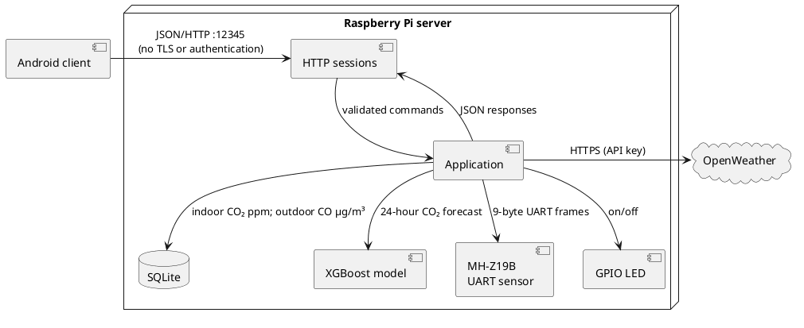

# CO₂ Measurement System

An educational Raspberry Pi and Android client/server project. The C++20 server reads indoor CO₂ concentration in parts per million from an MH-Z19B UART sensor, stores samples in SQLite, controls a GPIO LED, and exposes data to the Kotlin Android client over HTTP.



## Requirements and limits

The server requires real Raspberry Pi-compatible UART/GPIO hardware; no sensor simulator is included. Forecasting also requires a compatible XGBoost model at `server/build/bin/cpp_model.model`, which is not included. An OpenWeather API key is read from a local file. The prototype currently queries fixed Tokyo coordinates, and OpenWeather's `components.co` value is **carbon monoxide in µg/m³**, not outdoor CO₂; the Android chart labels it accordingly.

The HTTP API has no authentication or TLS. It binds to `127.0.0.1` by default; exposing it to a LAN with `-b` is an explicit development-only choice because any reachable client can read data and control the LED. Configure DNS/mDNS separately—the server no longer changes the host name or restarts system services.

## Server build and test

On Ubuntu/Debian, install CMake, `pkg-config`, a C++20 compiler, and the development packages for Boost system/filesystem, SQLite, spdlog, nlohmann-json, libgpiod, XGBoost, and OpenSSL. Then run:

```sh
cmake -S server -B server/build
cmake --build server/build
ctest --test-dir server/build --output-on-failure
```

Example hardware launch after supplying a model and API key file:

```sh
server/build/bin/MeasuringServer -b 192.168.1.10 -s /dev/ttyAMA0 \
  -i 10 -k ./open_weather_api_key.txt -l 18
```

The API accepts bounded JSON `POST /api/co2sensor` requests such as `{"cmd":"get_indoor","params":[]}`. Timestamps are server-local SQLite-style strings (`YYYY-MM-DD HH:MM:SS`).

## Android client

Open `client/` in Android Studio with SDK 34, or run `client/gradlew testDebugUnitTest assembleDebug` with an Android SDK configured. The development endpoint is currently `http://co2measure.local:12345/`; change `BASE_URL` for the selected server address.

This is a hardware-bound learning project, not a production or safety-monitoring system. See [LICENSE](LICENSE) for MIT terms.
